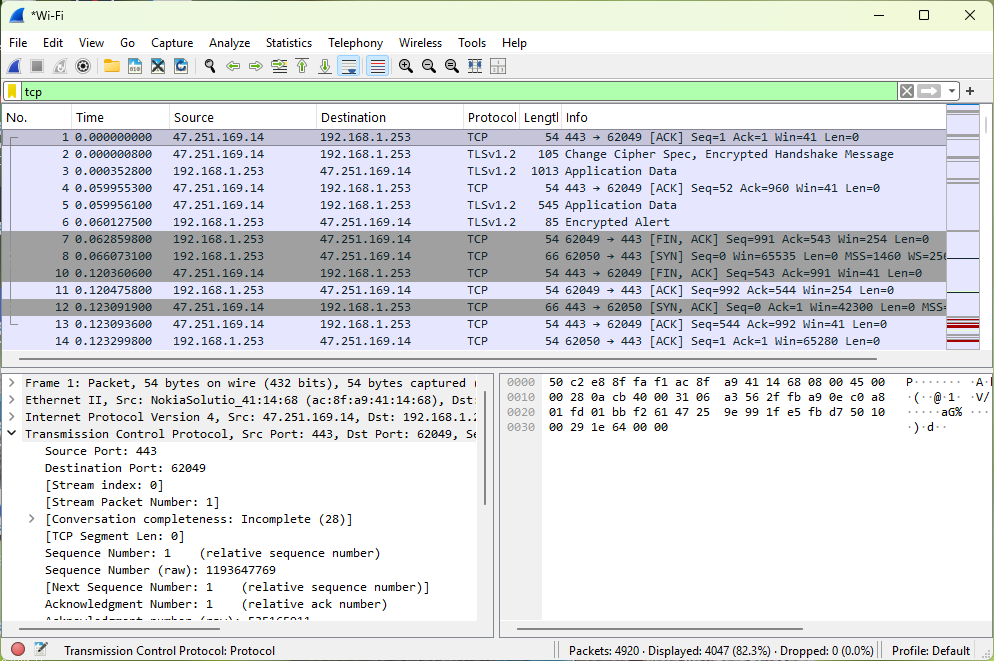

# Wireshark-Network-Traffic-Analysis

## Project Overview

This project demonstrates hands-on network traffic analysis using Wireshark on Windows 11.

I captured live network traffic through my Wi-Fi interface, applied protocol filters, and examined TCP packet information to develop practical network investigation skills relevant to cybersecurity and Security Operations Center (SOC) Analyst positions.

## Lab Environment

- Operating System: Windows 11
- Network Analysis Tool: Wireshark 4.6.9
- Network Interface: Wi-Fi
- Display Filter: tcp
- Capture Duration: Approximately 1 minute

## Project Objectives

- Capture live network packets.
- Identify source and destination IP addresses.
- Analyze TCP communication.
- Examine TCP source and destination ports.
- Identify TCP connection flags.
- Understand how packet analysis supports security investigations.

## Packet Capture and Analysis

### 1. Network Packet Capture

Captured 4,920 packets using the Wi-Fi interface in Wireshark.

### 2. TCP Traffic Filtering

Applied the following Wireshark display filter:

`tcp`

The filter displayed 4,047 packets, representing approximately 82.3% of the capture.

### 3. TCP Packet Inspection

Examined a selected TCP packet and identified:

- Source Port: 443
- Destination Port: 62049
- Packet Length: 54 bytes
- TCP Sequence Number: 1 (relative)
- TCP Acknowledgment Number: 1 (relative)

### 4. Network Traffic Observations

Observed TCP packets associated with HTTPS communication, along with TLS traffic and TCP connection-control flags.

The packet capture demonstrated normal network communication and did not establish evidence of malicious activity.

## Security Relevance

Network packet analysis helps cybersecurity analysts understand network communications, investigate connectivity problems, and identify traffic that may require further investigation.

## Skills Demonstrated

- Wireshark
- Network Traffic Analysis
- TCP/IP
- Packet Inspection
- Network Protocol Filtering
- Basic Network Security Analysis

## Project Evidence

### TCP Packet Capture and Analysis

The screenshot below demonstrates live network packet capture using Wireshark 4.6.9.

Applied the `tcp` display filter to examine TCP communications, source and destination ports, packet sizes, and sequence numbers.

The capture contained 4,920 packets, with 4,047 packets displayed after filtering.

## Lessons Learned

This laboratory strengthened my understanding of TCP communications, protocol filtering, and packet inspection using Wireshark.

All traffic was captured from my own authorized network environment.
